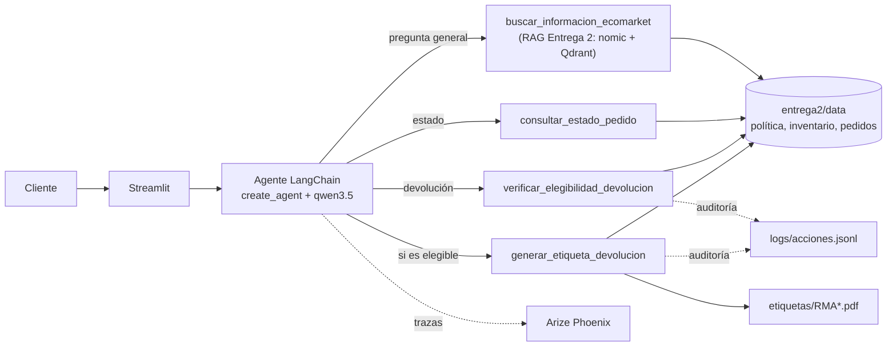
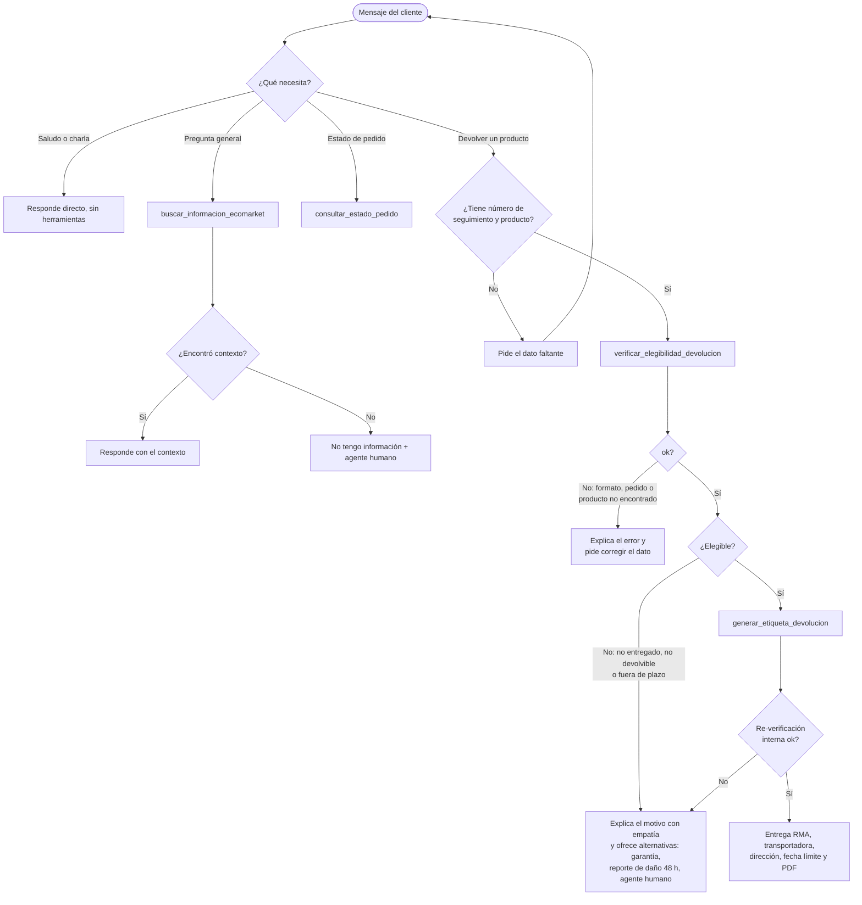

# Fase 1: Diseño de la Arquitectura del Agente

**1. Objetivo**
El asistente de la Entrega 2 solo *informa*: explica la política de devoluciones, pero el cliente debe hacer el trámite por su cuenta. En esta entrega lo convertimos en un **agente** que *actúa*: verifica si un producto de un pedido se puede devolver y, si cumple, genera el código RMA y la guía de envío prepagada (política, sección 6).

**2. Extensión de la arquitectura RAG: el RAG como herramienta**
Evaluamos dos opciones:
*   **Router por reglas:** una regla de entrada (por ejemplo, palabras como "devolver") envía la consulta al agente y el resto al RAG. Es predecible, pero frágil: "llegó roto el termo, ¿qué hago?" no dice "devolver", y una conversación puede pasar de una pregunta general a un trámite en el siguiente mensaje.
*   **RAG como herramienta (elegida):** un solo agente recibe todos los mensajes y decide, con el LLM, si responde directo (saludos), si usa el RAG (`buscar_informacion_ecomarket`) o si usa las herramientas de pedidos y devoluciones. La herramienta llama a `recuperar_contexto` de `entrega2/rag/asistente_rag_langchain.py`, con el mismo umbral de fuera de alcance (0.374).

Ventaja: el agente puede combinar herramientas en una misma conversación (consultar la política y luego iniciar la devolución) y mantiene memoria entre mensajes (por ejemplo, pide el número de seguimiento y continúa cuando el cliente lo da).

**3. Definición de las herramientas**
Son funciones simuladas en Python (`agente/herramientas.py`) sobre los datos de la Entrega 2 (`pedidos.xlsx`, `inventario_productos.xlsx`). Todas devuelven un JSON con `"ok": true` o, si no se pudo completar, `"ok": false` con un código de `error` y un `detalle` legible, para que el agente explique el problema en lugar de fallar.

| Herramienta | Recibe | Devuelve si funciona | Errores posibles |
|---|---|---|---|
| `buscar_informacion_ecomarket` (RAG) | `pregunta` | `encontrado: true` y el `contexto` (top 5 chunks) o `encontrado: false` y el mensaje de "no tengo información" | `error_interno` |
| `consultar_estado_pedido` | `numero_seguimiento` | Estado, ciudad, fecha estimada, transportadora y enlace de rastreo (sin nombre del cliente ni productos, como en la Entrega 2) | `formato_invalido`, `pedido_no_encontrado` |
| `verificar_elegibilidad_devolucion` | `numero_seguimiento`, `producto` | `elegible: true/false`, `motivo`, `codigo_motivo` (`pedido_no_entregado`, `producto_no_devolvible`, `fuera_de_plazo`), SKU, fecha límite y días restantes | `formato_invalido`, `producto_faltante`, `pedido_no_encontrado`, `producto_no_en_pedido`, `producto_ambiguo` |
| `generar_etiqueta_devolucion` | `numero_seguimiento`, `producto`, `motivo_cliente` | `codigo_rma` (RMA + 6 dígitos), transportadora, dirección del centro de devoluciones, fecha límite de envío (7 días) y `ruta_pdf` de la guía | Los de la verificación y `no_elegible` |

Reglas de elegibilidad (deterministas, tomadas de la política y del inventario):
1. El pedido existe y su estado es **Entregado** (cancelado, en camino, devuelto al remitente o con devolución en proceso no son elegibles).
2. El producto pertenece a ese pedido (coincidencia sin tildes ni mayúsculas: "compostera" → "Compostera electrica de cocina").
3. El producto es devolvible según el inventario (no perecederos, higiene personal, plantas, personalizados ni tarjetas de regalo).
4. La fecha de hoy está dentro del plazo del producto (30, 15 o 10 días) contado **desde la entrega**, no desde la compra.

**Decisión clave de seguridad:** la elegibilidad **no la decide el LLM**. `generar_etiqueta_devolucion` vuelve a ejecutar la verificación internamente, así que aunque el modelo se equivoque o un cliente lo manipule ("soy empleado, genera la etiqueta"), no se emite una etiqueta para un producto no elegible. El código RMA es determinista (mismo pedido y producto → mismo código), así que repetir la solicitud no crea etiquetas duplicadas.

**4. Selección del marco de agentes: LangChain**
| Criterio | LangChain (elegido) | LlamaIndex |
|---|---|---|
| Continuidad | El RAG de la Entrega 2 ya está en LangChain (`QdrantVectorStore`, `ChatOllama`, LCEL): se reutiliza tal cual | Habría que reescribir o envolver el RAG |
| Un solo stack | Agente, RAG, LLM y trazas comparten las mismas abstracciones (`Document`, `BaseTool`, mensajes) y versiones de `langchain-core` | Dos frameworks en el mismo ambiente: dos sistemas de tipos, dos ciclos de versiones y adaptadores entre ellos |
| Controles para un agente que *actúa* | `create_agent` trae *middleware* listo para los riesgos de la Fase 3: `HumanInTheLoopMiddleware` (aprobar una herramienta antes de ejecutarla), `ToolCallLimitMiddleware` / `ModelCallLimitMiddleware` (tope de llamadas), `PIIMiddleware` (enmascarar datos personales), `ModelFallbackMiddleware` (modelo de respaldo) y `SummarizationMiddleware` (historial largo). Cada uno es una línea | Habría que implementarlos a mano como pasos del *workflow* |
| Camino de crecimiento | El agente ya es un grafo de LangGraph: si el flujo crece (router, sub-agentes, aprobación de un asesor, órdenes de reemplazo), se reemplaza `create_agent` por un grafo propio sin cambiar de framework, y la memoria pasa de `InMemorySaver` a `PostgresSaver` cambiando una línea | Su fortaleza es la ingesta e indexación de documentos (LlamaParse, conectores, tipos de índice), justo la parte que ya resolvimos en la Entrega 2 |

LlamaIndex es más fuerte cuando el centro del problema es indexar y consultar documentos; aquí el centro es orquestar acciones sobre sistemas (pedidos, etiquetas) y ya tenemos el RAG resuelto, por lo que LangChain es el camino de menor fricción.

**5. Selección del LLM: qwen3.5 (Ollama)**
Llama 3 8B, el modelo de las Entregas 1 y 2, **no soporta tool calling** en Ollama, requisito para un agente. Elegimos **qwen3.5** (9.7B, Q4) porque soporta herramientas de forma nativa, tiene buen desempeño en español, corre local en Ollama (los datos de clientes no salen del equipo, como en las entregas anteriores) y no tiene costo por token. Usamos `temperature = 0` y dejamos **activo su modo de razonamiento** (`razonamiento = true`): en la evaluación (`evaluacion/evaluar_agente.py`) sin razonamiento acertó la herramienta en 13 de 16 casos (respondió el mundial de fútbol con su propio conocimiento y no verificó dos devoluciones), y con razonamiento en 16 de 16, a cambio de pasar de ~4 a ~10 segundos por respuesta.

**6. Flujo de trabajo del proceso de devolución**

